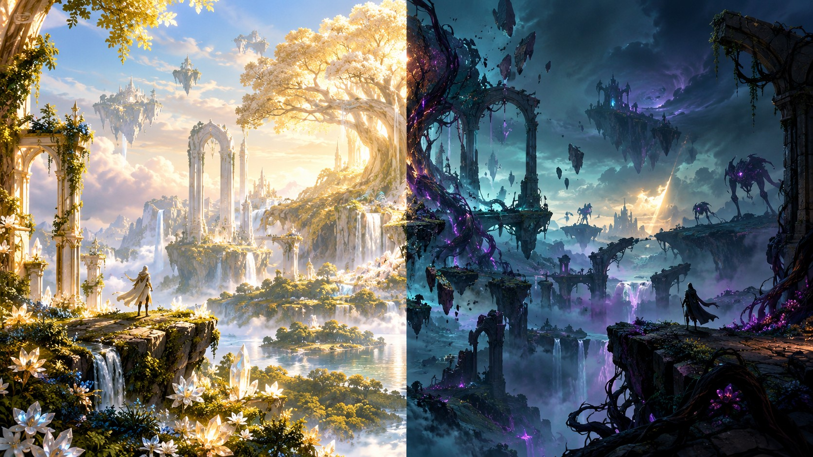

<div align="center">



# KAIRÓS INTERACTIVE

**Cada ideia tem o seu momento.**

Site institucional de uma iniciativa independente de jogos autorais e soluções digitais.
Mais do que uma vitrine, o site é um diário público: mostra o que já foi pensado, o que está sendo construído e o que ainda é só ideia.


<!-- Adicione aqui o link do site publicado, por exemplo: [**Ver o site ao vivo →**](https://...) -->

</div>

---

## Sobre a Kairós

A **Kairós Interactive** é uma iniciativa independente dedicada a criar produtos digitais próprios, em duas frentes:

- **Jogos autorais e experimentais**, reunidos em uma saga narrativa conectada.
- **Aplicações web** que tentam resolver problemas reais.

O nome vem do grego *kairós*, o momento certo para agir. A iniciativa existe porque há ideias que merecem sair do papel, e está em fase inicial: há conceitos e planejamento, e a capacidade de levar projetos até o fim ainda está sendo construída. Por isso o site adota uma regra simples: **mostrar o estado real de cada coisa**. Todo projeto traz um selo de status (Conceito, Em desenvolvimento ou Disponível), e nada é apresentado como mais avançado do que é.

## Os projetos

### A saga: cinco jogos, uma história

Os jogos formam uma sequência que parte da origem do universo e chega a uma conclusão de escala global.

| # | Jogo | Gênero | Ideia central | Status |
|---|------|--------|---------------|--------|
| 1 | **ORIGIN: Breath of Light** | Aventura contemplativa 2D | Participar do nascimento de um novo mundo por meio da exploração, de enigmas e da manipulação da luz. Sem combates tradicionais. | Conceito |
| 2 | **EDENFALL** | Metroidvania 2D | Depois da queda do Jardim de Origem, os guardiões Aelion e Seraphyn enfrentam as consequências de suas escolhas em um mundo fragmentado. | Conceito |
| 3 | **AFTERTIME** | Aventura cinematográfica 3D | O Restaurador das Linhas atravessa eras e linhas temporais corrompidas para recuperar os fragmentos que restauram a continuidade do tempo. | Conceito |
| 4 | **THE HOLLOW** | Survival horror 3D | Um investigador segue o desaparecimento de pesquisadores até um complexo arqueológico isolado, onde escavações revelaram estruturas que desafiam a história humana. | Conceito |
| 5 | **REQUIEM: THE LAST DAY** | Aventura cinematográfica 3D | Capítulo final: a humanidade enfrenta uma crise que ultrapassa qualquer explicação conhecida, convergindo os mistérios dos jogos anteriores. | Conceito |

> Os nomes estão sujeitos a alteração. Nenhum dos jogos tem versão jogável ainda, e a arte exibida é ilustrativa.

### Soluções digitais

| Projeto | Área | Proposta | Status |
|---------|------|----------|--------|
| **Econ Radar** | Web · Mercados financeiros | Plataforma para acompanhar mercados: cotações, histórico recente de preços, análises com auxílio de IA e um indicador de 0 a 100 personalizado ao perfil do usuário, como apoio à análise. *Não é recomendação financeira, previsão de mercado nem garantia de resultado.* | Conceito |
| **Lixeira Tech** | Web · Sustentabilidade | Sistema gamificado de reciclagem de lixo eletrônico voltado a escolas: registro de resíduos, uso de pontos de coleta locais e dinâmica de incentivos (ainda em avaliação). | Conceito |

### Extras (páginas secundárias)

Além da vitrine principal, o site tem abas secundárias no menu (depois do divisor): **Jogos**, **Softwares** e **Colecionáveis** (bonecos e itens físicos dos personagens). Aba sem itens mostra um estado vazio honesto ("Em breve, no momento certo.") em vez de esconder a página.

- **Lista** (`/#/jogos`): grade no estilo "lineup", com arte, selo de estado e link "Explorar". Em Jogos, os cards levam algarismos romanos (I a V), porque a saga é uma sequência; nas outras abas a numeração é 01, 02...
- **Túnel da saga** (só na aba Jogos): conforme a página rola, os cards voam em perspectiva até a câmera, na ordem da saga. Embaixo, uma legenda mostra o capítulo que está passando e o seu "papel na saga". Cada card emite uma luz com a cor mais forte da própria arte (extraída da imagem no navegador).
- **Página individual** (`/#/jogos/origin`, `/#/softwares/econ`...): topo com parallax em camadas, seções (visão geral, destaques ou papel na saga, galeria, estado real, próximo item), título fixo que muda por seção, régua de progresso com porcentagem e efeitos de entrada ligados ao scroll.
- **Transição entre páginas:** ao trocar de página (por exemplo, de um jogo para o próximo), a tela antiga recua e a nova chega com um fade suave, já no topo. Usa a View Transitions API; em navegadores sem suporte, a troca é direta.
- Os 5 jogos e os 2 softwares de `projects.ts` entram sozinhos nas abas, sem duplicar conteúdo.
- **Paleta:** preto e dourado (`#f2b544`) em todas as listas. Dentro de cada página individual vale a cor própria do projeto (definida em `ACCENT`, em `projects.ts`).

### Este site

O próprio **site da Kairós** também é um projeto em andamento e é atualizado conforme os demais avançam. Este repositório é ele.

## Como o site funciona

O site foi pensado como uma experiência de scroll narrativo, com foco em atmosfera sem abrir mão de desempenho e acessibilidade.

**Hero de partículas interativas.** A logo é lida em um canvas e transformada em milhares de partículas com física de mola: elas se dispersam ao redor do cursor e voltam ao lugar, deixando rastros dourados. Atrás, uma arte de fundo escurecida é revelada em cores por um spotlight que acompanha o mouse.

**Projetos em capítulos.** Uma seção "sticky" transforma o scroll em navegação: cada projeto ocupa a tela inteira, com fundo próprio, cor de destaque, tagline em serifa itálica, resumo, nota de status e, quando existe, link para a página do projeto. Os jogos vêm primeiro, depois as soluções. Um número gigante em contorno marca o capítulo atual, e uma navegação lateral por pontos permite pular entre eles.

**Detalhes de acabamento.** Scroll suave com Lenis, faixa em movimento com os nomes dos jogos, grão de filme e vinheta sobre a página, seções numeradas e um wordmark "Kairós" preenchido com a arte do Edenfall no fim da página.

**Performance.**
- Canvas limitado a 1.5x de resolução e densidade de partículas ajustada.
- Partículas em repouso desenhadas em lote; só as perturbadas pelo cursor são desenhadas individualmente.
- Limpeza parcial do canvas depois da animação de entrada.
- Spotlight animado por `transform`, sem recalcular máscaras a cada movimento.

**Acessibilidade.**
- Link "Ir para o conteúdo" e landmarks semânticos.
- Rótulos ARIA, incluindo a navegação por capítulos.
- Respeito a `prefers-reduced-motion`: scroll suave, partículas, marquee, túnel 3D e transições de página são desativados (quem prefere menos movimento fica com a lista completa de jogos).
- Foco visível em todos os elementos interativos e navegação por teclado nas abas, cards e links de "Próximo".

## Stack

| Camada | Tecnologia |
|--------|-----------|
| Interface | React 18 + TypeScript 5.6 |
| Build | Vite 6 |
| Estilo | Tailwind CSS v4, estrutura no padrão shadcn (`src/components/ui`, alias `@/`) |
| Animação | GSAP + ScrollTrigger (páginas individuais), Motion (túnel 3D, glass-card), Lenis (scroll suave), Canvas 2D (partículas e cor dos cards), View Transitions API (troca de página) |
| Tipografia | Archivo, Inter e Cormorant Garamond itálico |

## Rodando localmente

Requer Node.js 18 ou superior.

```bash
git clone https://github.com/JoaoAntonio08/kairos-site.git
cd kairos-site
npm install
npm run dev
```

| Comando | O que faz |
|---------|-----------|
| `npm run dev` | Servidor de desenvolvimento |
| `npm run build` | Checagem de tipos + build de produção em `dist/` |
| `npm run single` | Build em um único arquivo HTML, com tudo embutido |
| `npm run preview` | Serve o build localmente |

## Estrutura

```
src/
├── App.tsx                  # página: header, hero, marquee, seções e rodapé
├── components/
│   ├── extra-page.tsx       # lista dos Extras (grade "lineup" + túnel)
│   ├── entry-page.tsx       # página individual de cada item dos Extras
│   ├── chapters.tsx         # seção de projetos em capítulos
│   ├── backdrop.tsx         # fundo dinâmico dos capítulos
│   └── ui/
│       ├── liquid-sculpture-hero.tsx   # hero com partículas e spotlight
│       ├── perspective-tunnel.tsx      # túnel 3D da saga: legenda por capítulo e luz por card (aba Jogos)
│       ├── timeline.tsx                # "Como trabalhamos"
│       └── glass-card.tsx
├── data/
│   ├── site.ts              # contatos, mídia, navegação, etapas da filosofia
│   ├── projects.ts          # projetos, textos e status
│   └── extras.ts            # abas secundárias e seus itens (Jogos, Softwares, Colecionáveis)
├── lib/
│   ├── smooth.ts            # scroll suave (Lenis)
│   ├── router.ts            # rotas por hash (#/jogos) + transição de página
│   └── ui.ts                # classes compartilhadas
└── assets/                  # imagens importadas pelo código
public/media/                # vídeos, posters e logo
public/media/extras/         # imagens dos itens dos Extras
```

## Editando o conteúdo

Quase todo o conteúdo vive em três arquivos, sem tocar nos componentes:

- **`src/data/projects.ts`**: para adicionar um projeto, inclua um item na lista `ROADMAP`. Escolha o status (`concept`, `dev` ou `on`) apenas com base em informação real.
- **`src/data/site.ts`**: canais de contato (deixe `""` onde não houver canal oficial e nenhum link é criado), vídeos e etapas da filosofia.
- **`src/data/extras.ts`**: abas secundárias e seus itens (veja abaixo).

Vídeos, posters e a logo oficial ficam em `public/media/`.

### Contando a história na página individual

Cada projeto em `src/data/projects.ts` aceita `beats` (3 a 4 frases curtas) e `sign` (frase de assinatura). Os `beats` aparecem como pausas entre as seções (antes da visão geral, dos destaques, da galeria e do estado real), e as palavras acendem conforme a página rola. O `sign` fecha a página, antes do "Continue". Sem `beats`, a página fica como antes. Para itens só dos Extras, os mesmos campos existem em `extras.ts`.

### Adicionando itens aos Extras

- **Jogo ou software novo:** adicione-o em `src/data/projects.ts` (lista `ROADMAP`). Ele aparece na home, na aba correspondente e ganha página própria, sozinho.
- **Algo só dos Extras** (demo, ferramenta pequena, boneco, item físico): abra `src/data/extras.ts` e inclua um objeto em `items` da categoria. Só `id`, `name`, `status` e `description` são obrigatórios; tudo o que mais você preencher vira seção na página individual.

```ts
{ id: "kairos-notes", name: "Kairós Notes", status: "dev", description: "Bloco de notas leve para roteiros de jogos.",
  image: "/media/extras/kairos-notes.jpg",                  // capa (arquivo em public/media/extras/)
  tags: ["Windows", "v0.2"], price: "R$ 0",                  // selos e preço
  summary: ["Parágrafo 1...", "Parágrafo 2..."],             // visão geral
  points: ["Recurso A", "Recurso B"],                        // destaques numerados
  gallery: [{ src: "/media/extras/notes-1.jpg", caption: "Tela principal" }],
  note: "Versão de testes, pode conter erros.",              // aviso de estado real
  link: { label: "Baixar", href: "https://..." } }           // botão externo
```

- **Nova versão de um software:** edite `tags` (ex.: `"v0.3"`), `status` e `link` do mesmo item.
- **Nova aba** (ex.: "Wallpapers"): copie um bloco de categoria inteiro em `EXTRAS`. Menu, rodapé e rotas são gerados sozinhos.
- **Remover uma aba:** apague o bloco da categoria.
- `status` segue a regra do site: só com base em informação real (`concept`, `dev` ou `on`).
- **Opções de uma aba** (em `EXTRAS`): `accent` (cor da aba), `unify: true` (os cards da lista usam a cor da aba, não a de cada item), `numerals: "roman"` (cards numerados em romanos) e `showcase` (liga o túnel 3D, que precisa de 3 ou mais itens com imagem). Itens com o campo `saga` ganham a legenda "papel na saga" no túnel.

## Histórico de versões

| Versão | Resumo |
|--------|--------|
| **v0.5.0** | História em falas curtas ao longo da página individual (jogos e softwares), 8 colecionáveis com imagens recortadas e layout em pé na aba Colecionáveis |
| **v0.4.0** | Abas Extras (Jogos, Softwares, Colecionáveis) com página individual por item, túnel 3D da saga com luz por card, transição suave entre páginas e menu com as novas abas |
| **v0.3.0** | Marquee, numeração de seções, wordmark final e otimização do hero |
| **v0.2.0** | Projetos em capítulos, scroll suave com Lenis e hero com arte e spotlight |
| **v0.1.0** | Versão inicial: hero interativo, projetos, roadmap, sobre, filosofia e contato |

Detalhes das notas completas em [Releases](../../releases).

## Contato

- E-mail: kairos.interactiveoficial@gmail.com
- Instagram: [@kairosint__](https://www.instagram.com/kairosint__)

## Direitos

© Kairós Interactive. Todos os direitos reservados.

O código-fonte está público para consulta, mas **não há licença de uso**: sem autorização, ele não pode ser copiado, modificado ou redistribuído. Textos, nomes, logo, vídeos e imagens dos projetos são parte da obra autoral da Kairós. Os visuais são ilustrações conceituais, não capturas de produtos.
